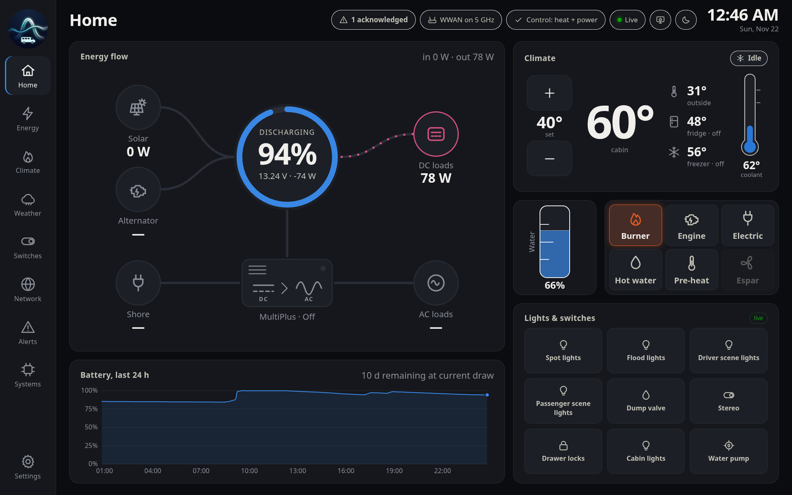
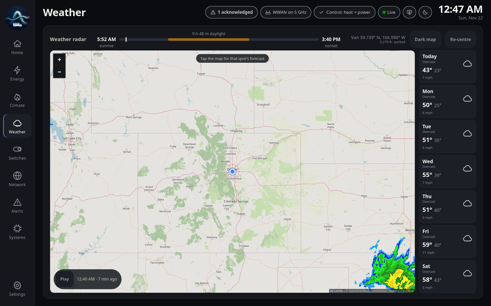
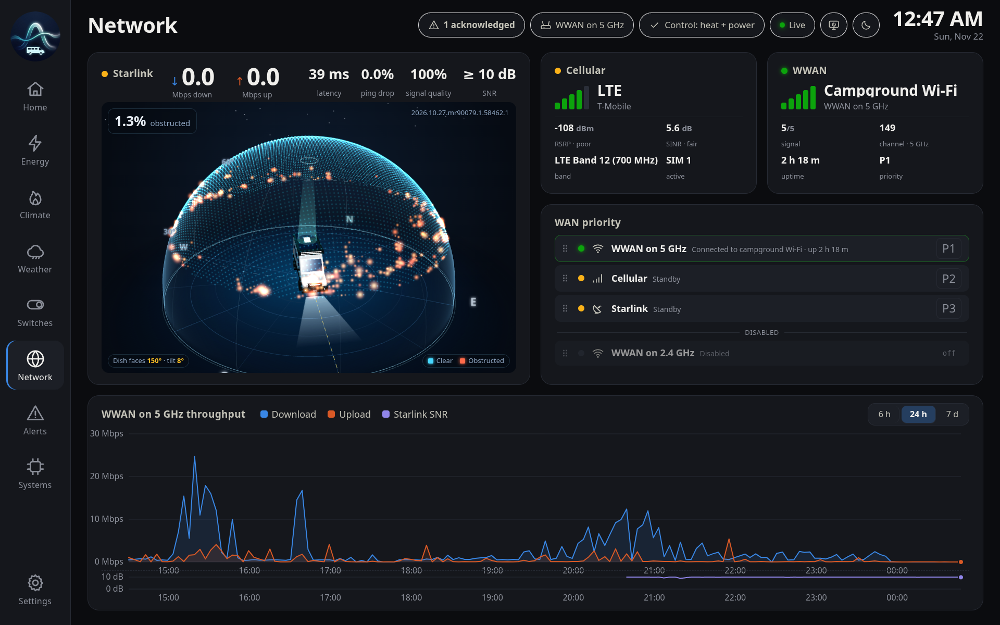

# AetherRV

A touchscreen console for a camper van, running on a Raspberry Pi 5: power, climate, network and switching on one
screen, with chrome from the [AetherSDR](https://aethersdr.com) project.



   

- **Energy:** a Victron Cerbo GX over MQTT shows battery, solar, shore, alternator, inverter and loads as an
  animated flow, with history. It controls MultiPlus mode, shore current limit and MPPT on/off. Individual
  lithium batteries with a RoyPow BMS (e.g. EPOCH) are read over Bluetooth: SoC, current, cells,
  temperatures and faults per battery.
- **Climate:** Rixens MCS7 hydronic heat over its local HTTP API shows setpoint, fan, heat sources, hot water,
  engine pre-heat, burner diagnostics and fuel flow. Fridge and freezer temperatures come from Cerbo sensors.
- **NMEA 2000:** device list and digital switching (Carling/Maretron CLMD16 load controller and CKM12 keypads).
  It shows on/off, dimmer level, per-channel current and the controller's wired inputs. It can switch and dim
  (126208 commands, gated) and optionally run the keypad logic, via the Cerbo's `socketcand` or a CAN HAT.
- **Network:** Starlink (local gRPC), Peplink router API, GPS (NMEA 0183 over UDP), device health checks, and a
  weather radar with a 7-day forecast for the van's position.
- **Settings:** Wi-Fi (iwd), Tailscale, system updates, rename, screen auto-off, reboot. The time zone is set
  automatically from GPS.
- **Kiosk:** sway + Chromium, screen off with touch-to-wake, and a Plymouth boot/shutdown splash.

## Safety model

- **Deny by default.** A `TxGate` refuses every write until a device's `tx_enabled` is set in the Pi's own config.
- **Careful command path.** Every command reads fresh state, sends only if the value differs, sends once,
  verifies the result and never retries. Each command is logged.
- **Who can control.** By default, controls and settings changes work only from the van's touchscreen
  (loopback) or from devices owned by the same Tailscale user as the console. `[web] control_subnets` can
  also trust whole LANs, and `control_tailnet = "all"` can trust every tailnet device. Everything else is
  view-only.
- **The devices stay in charge, with one deliberate exception.** Heat, power, Starlink and every other control
  only act when a person asks. The exception is optional NMEA 2000 **switching logic**: keypad bindings, groups
  and "output follows input" rules can run in AetherRV, with the load controller as a plain output box. When
  enabled (`[device.n2k.switching] automation`), those keypads and input-driven outputs do nothing while the
  Pi is off or restarting. Anything that must work without the Pi, such as a solenoid's cut-off timer, belongs
  in the load controller's own configuration. Until it's there, that channel is `blocked` (it refuses ON).
- **Root access is minimal.** The only root component is a small, socket-activated helper with a fixed list of
  validated actions. Wi-Fi passwords never appear in logs, the live state or command lines.

## Layout

| Path | What |
|---|---|
| `src/aetherrv/` | Python asyncio backend: adapters, state, history (SQLite), alerts, settings, web/WebSocket |
| `web/` | The touch UI (vanilla JS modules; Leaflet and qrcode-generator vendored) |
| `deploy/` | systemd units, kiosk (sway), admin helper, installer, boot splash, networkd/iwd files |
| `config/aetherrv.example.toml` | **Sample** configuration. Copy it and fill in your devices |
| `tools/` | Pairing and setup helpers, bench traffic generators, hero renderer |
| `tests/` | pytest suite |

## Install (on the Pi)

```sh
cp deploy/local.env.example deploy/local.env     # set AETHERRV_HOST to your Pi's ssh host
./deploy/push.sh                                 # rsync to /opt/aetherrv and run deploy/install.sh
```

`install.sh` creates `/etc/aetherrv/aetherrv.toml` from the sample only if it's missing. Edit it on the Pi
with your devices' addresses. Secrets (Victron MQTT token, Peplink read-only credentials) go in
`/etc/aetherrv/secrets.toml` (root:aetherrv 0640), written by the tools in `tools/`, never into the repo.

The boot splash changes `/boot` and is a separate, one-time step: `sudo /opt/aetherrv/tools/install_boot_splash.sh`.

## Development

```sh
uv sync --extra dev && uv run pytest -q
```

`INTEGRATION_PLAN.md` is the (sanitized) build log: protocol findings, decisions and verification notes.

## License

GPL-3.0 — see [LICENSE](LICENSE).
