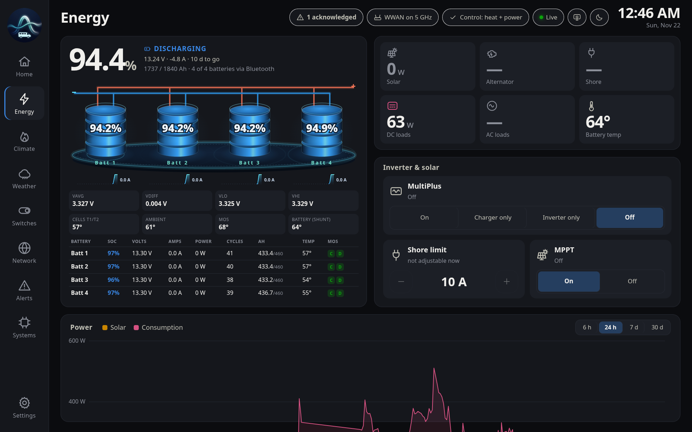
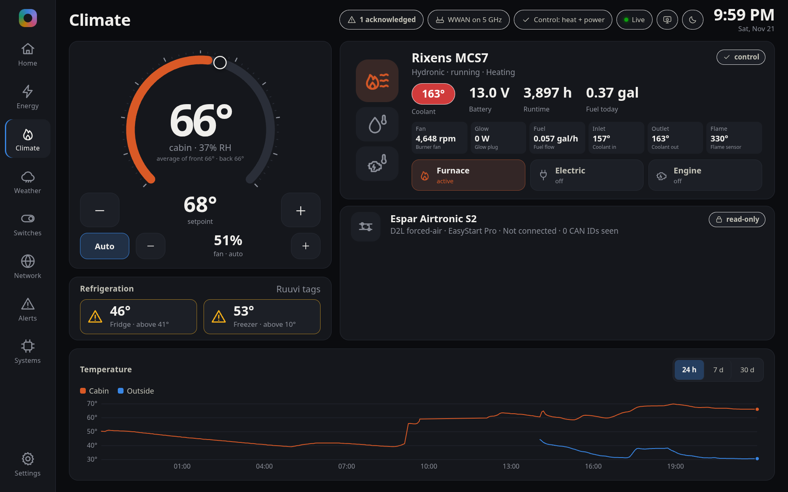

# AetherRV

A touchscreen console for a camper van, running on a Raspberry Pi 5: power, heat, climate, network and switching on
one screen. The same pages work in a browser on a phone or laptop.


   

- **Home:** the van at a glance: an animated energy flow, the battery's last 24 h, the cabin temperature with its
  setpoint, the water tank, one-tap heat sources and your favourite lights and switches.
- **Energy:** a Victron Cerbo GX over MQTT shows battery, solar, shore, alternator, inverter and loads, with history
  from 6 h to 30 days. It sets the MultiPlus mode, the shore current limit and MPPT on/off, and acknowledges the
  Cerbo's alarms. Lithium batteries with a RoyPow BMS (e.g. EPOCH) are read over Bluetooth into a 3D bank: SoC,
  current, cells, temperatures, cycles, charge/discharge state and faults per battery.
- **Climate:** a drag-to-set cabin dial with a fan slider, cabin temperature and humidity from Ruuvi tags (through
  the Cerbo), fridge and freezer temperatures, and temperature history.
  - **Rixens MCS7** hydronic heat over its local HTTP API: setpoint, fan, heat sources (furnace, electric, engine),
    hot water, engine pre-heat, burner diagnostics, fuel flow, fault codes and hours.
  - **Espar Airtronic S2** diesel heater over CAN, with AetherRV as its controller (in place of the EasyStart Pro):
    heat to a setpoint or fan only, with a run timer; live diagnostics (flame, glow plug, fuel pump, blower,
    temperatures, altitude compensation), logged to history; the heater's fault memory, runtime and fuel counters.
- **Switches:** NMEA 2000 digital switching with a Carling/Maretron CLMD16 load controller and CKM12 keypads: on/off,
  dimming, per-channel current and the controller's wired inputs (e.g. ignition), in groups, over a CAN HAT with the
  Cerbo's `socketcand` as a fallback. A momentary trigger presses one of the controller's virtual switches whose logic
  (e.g. a timer) lives in the controller; a channel can also require an input to be on (an interlock) or be blocked.
- **Weather:** a radar loop (LibreWXR: 2 h of radar and a 1 h nowcast, with older frames recorded on the Pi) or IR
  satellite, over a street, satellite or topographic map with public lands and optional TomTom traffic; tap any spot
  for its forecast. A 7-day forecast and a sunrise/sunset bar for the van's position (GPS from the router's NMEA
  0183 over UDP).
- **Network:** Starlink over its local gRPC API: speeds, latency, a 3D obstruction sky with the van, events and
  outages, power use; reboot, sleep schedule, snow-melt heating and firmware updates. The Peplink router API: cellular
  signal, band and SIM, the Wi-Fi WAN, data allowance, and a drag-to-reorder WAN priority list with enable/disable.
  Throughput history with Starlink SNR, and reachability checks for devices on the van LAN.
- **Alerts:** low battery, BMS and cell faults, heater faults (live and stored), tripped breakers, quiet CAN buses and
  NMEA 2000 devices, Cerbo alarms, data allowance, fridge/freezer temperatures, unreachable devices and any module
  that is down, with a recent-events log. Alerts are acknowledged on the console; the panel chimes for a new serious
  one (and for warnings in day mode).
- **Systems:** module health, which devices may transmit, the Cerbo, the Espar's CAN frames, the NMEA 2000 device
  list and a live CAN bus inspector.
- **Power guard:** on a low house battery the heaters are locked out and turned off, and the console shuts itself
  down cleanly before the battery runs out (charging cancels it).
- **Settings:** Wi-Fi (iwd), Tailscale (install, and sign in by QR code), Starlink, MCS7 and Espar details, system
  updates (kernel and boot packages held), device name, screen auto-off, night mode, reboot and power off. The time
  zone follows GPS.
- **Panel:** sway and WPE WebKit (chosen by benchmark: [`docs/UI-RUNTIME-BENCHMARK.md`](docs/UI-RUNTIME-BENCHMARK.md)),
  screen off with touch-to-wake, and a Plymouth boot/shutdown splash. Phones and laptops get the same React app in
  Safari, Chrome or Firefox: view-only unless they are trusted (see "Who can control" below).

AetherRV is written in Rust: one small service per device plus a few core services, talking over a local MQTT
broker, with a React + TypeScript UI. It replaced the original Python system, which was the reference it was tested
against (197 ported tests, golden-parity replays of real CAN captures); that system is in the git history (tag
`python-final`). See [`docs/ARCHITECTURE.md`](docs/ARCHITECTURE.md).

## Safety model

- **Deny by default.** A `TxGate` refuses every write until a device's `tx_enabled` is set in the Pi's own config.
- **Careful command path.** Every command reads fresh state, sends only if the value differs, sends once,
  verifies the result and never retries. Each command is logged.
- **Who can control.** By default, controls and settings changes work only from the van's touchscreen
  (loopback) or from devices owned by the same Tailscale user as the console. `[web] control_subnets` can
  also trust whole LANs, and `control_tailnet = "all"` can trust every tailnet device. Everything else is
  view-only.
- **The devices stay in charge.** Heat, power, Starlink, switching and every other control only act when a
  person asks. NMEA 2000 keypads, groups, timers and "output follows input" rules live in the load
  controller's own configuration (dual control), so they keep working while the Pi is off; AetherRV never
  relays keypad presses or switches anything on by itself. A channel whose safety logic isn't in the load
  controller yet is `blocked` (it refuses ON).
- **Root access is minimal.** The only root component is a small, socket-activated helper with a fixed list of
  validated actions. Wi-Fi passwords never appear in logs, the live state or command lines.
- **Isolation.** Every device has its own process and systemd unit. A crash, restart or upgrade of one module (or
  of the broker) leaves the others running; this is tested by killing each one in turn under systemd while a
  simulated heater runs.
- **The Espar never notices a restart.** The Espar service owns the heater's CAN port and keeps the cyclic frames
  going itself, with no runtime dependency on the broker, gateway or UI. If it restarts mid-run it re-attaches to
  the running heater without a new start-up or an OFF; with no bus contact for a grace period it turns the heater
  off. Heat lockout on a low battery is enforced by a guard and again inside each heater service.

## Layout

| Path | What |
|---|---|
| `crates/` | Shared libraries: `core` (bus client, state, commands, TxGate, config), `can` (SocketCAN, socketcand, failover, capture), protocol codecs (`proto-n2k`, `proto-espar`, `proto-roypow`, `proto-nmea`, `proto-mcs7`), `power`, `sim` (device simulators) |
| `services/` | One binary per device or core function: `espar`, `n2k`, `rixens`, `victron`, `batteries-ble`, `starlink`, `peplink`, `gps`, `weather`, `netmon`, `can-aux`, `power-guard`, `alerts`, `history`, `derive`, `settings`, `gateway` (web + WebSocket), `screen`, and `admind` (the root helper) |
| `ui/` | The React + TypeScript touch UI (Vite; Leaflet and three.js bundled, no CDN) |
| `sims/` | Simulator binaries for the bench: Espar heater, CLMD16 + keypads, MCS7, Cerbo, EPOCH batteries, Starlink, Peplink, GPS, CAN capture replay |
| `utils/` | `aetherrv-ctl` (bus client), `aetherrv-migrate` (checks config, secrets, history and settings), `aetherrv-setup` (Victron pairing, the Peplink read-write API client, secrets writes), the isolation and soak tools, and the UI runtime benchmark (`uibench`) |
| `packaging/` | systemd units, the panel session, Mosquitto config, network/PAM/boot-splash files, the system update, installer, `push.sh`, staged transmit (`cutover.sh`) |
| `harness/` | Test harnesses: the bench scripts, UI screenshots, the runtime benchmark, the licence list (`crates.sh`) |
| `tools/` | Laptop-side setup (Peplink API clients, the TomTom key), the boot splash, the N2K table generator, read-only van access |
| `config/aetherrv.example.toml` | **Sample** configuration. Copy it and fill in your devices |

## Install (on the Pi)

**Building one from scratch?** [`docs/BUILD-GUIDE.md`](docs/BUILD-GUIDE.md) walks through the hardware, installing
and configuring Arch Linux ARM, wiring the CAN buses, and has prompts for adapting AetherRV with an AI assistant
when your equipment differs.

```sh
packaging/push.sh <your-pi> --system     # rsync, native cargo build on the Pi, install, enable and start
```

`push.sh` never has a default host. `--system` is for a fresh console; a console that still runs the old Python
system switches with the runbook in [`docs/CUTOVER.md`](docs/CUTOVER.md) (read-only first, then one
device at a time).

The installer creates `/etc/aetherrv/aetherrv.toml` from the sample only if it's missing. Edit it on the Pi with
your devices' addresses. Secrets (Victron MQTT token, Peplink API clients and read-only login, TomTom key) go in
`/etc/aetherrv/secrets.toml` (root:aetherrv 0640), written by `aetherrv-setup` and the tools in `tools/`, never into
the repo. The boot splash changes `/boot` and is a separate, one-time step: `sudo tools/install_boot_splash.sh`.

## Development

```sh
harness/dev-setup.sh                      # once per boot: the virtual CAN interfaces the tests use (sudo)
cargo test --workspace                    # Rust: unit, integration and process tests (vcan + a private Mosquitto)
(cd ui && npm ci && npx vitest run && npx playwright test)   # UI: unit tests and smoke tests against a stubbed gateway
```

No containers: everything runs as plain processes. The simulators let the whole system run on a Pi with no van
attached (`harness/bench/bench-up.sh`). [`docs/TEST-PARITY.md`](docs/TEST-PARITY.md) maps each test of the Python
system to its Rust or UI equivalent, and [`docs/STATUS.md`](docs/STATUS.md) holds the evidence for the conversion.
`harness/ui-reference/screenshots.sh` remakes the screenshots above from a console's state, sanitized, with every
command blocked.

`INTEGRATION_PLAN.md` is the (sanitized) build log: protocol findings, decisions and verification notes.

## License

GPL-3.0 — see [LICENSE](LICENSE).
